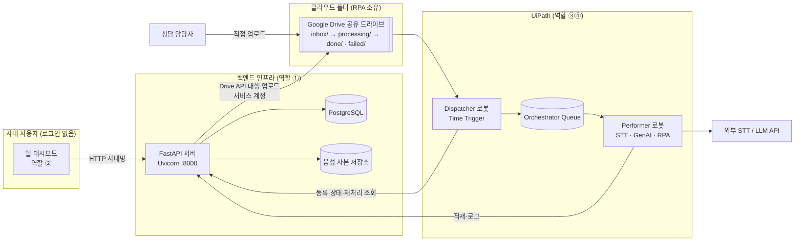
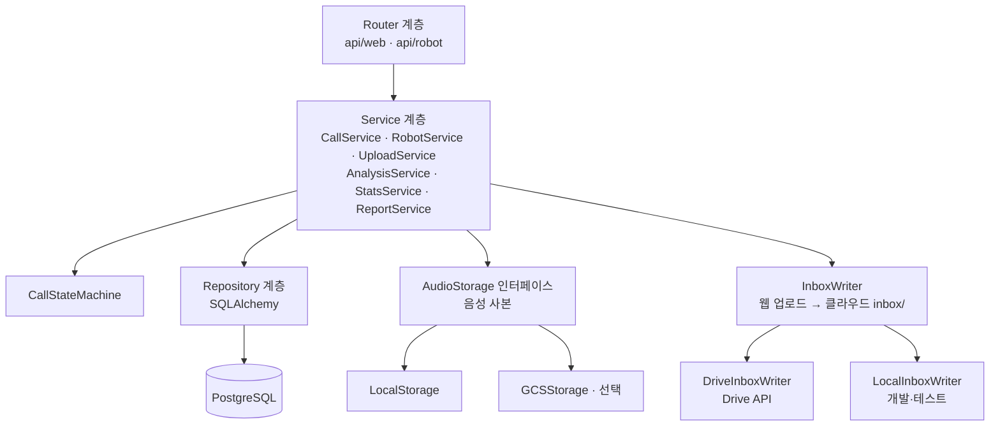
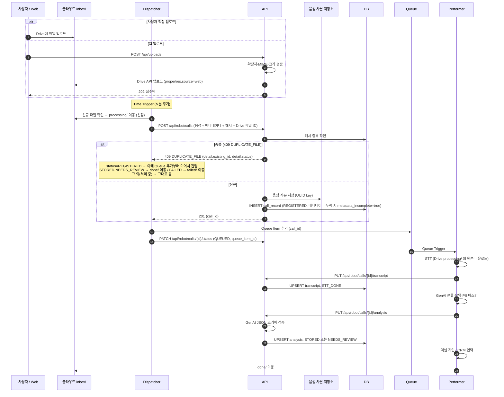
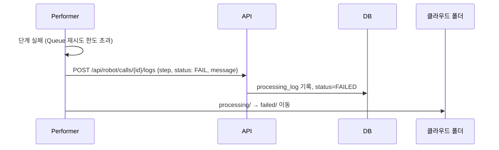
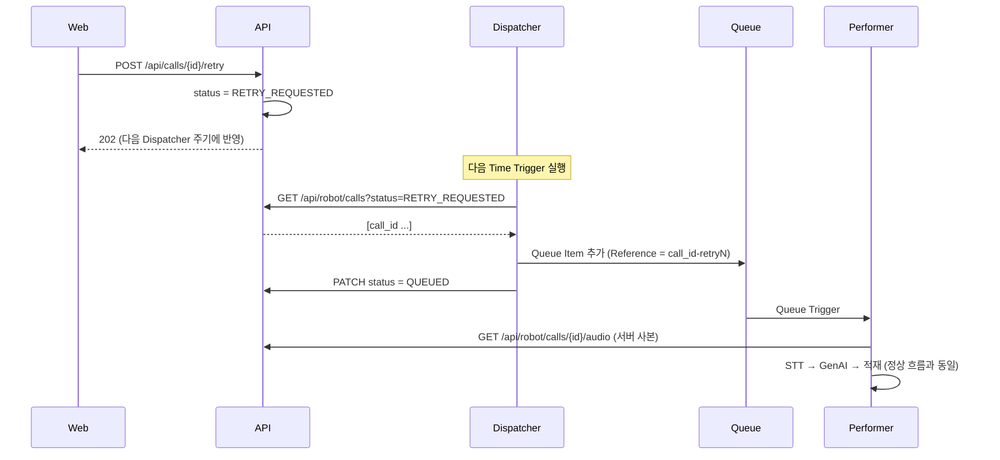
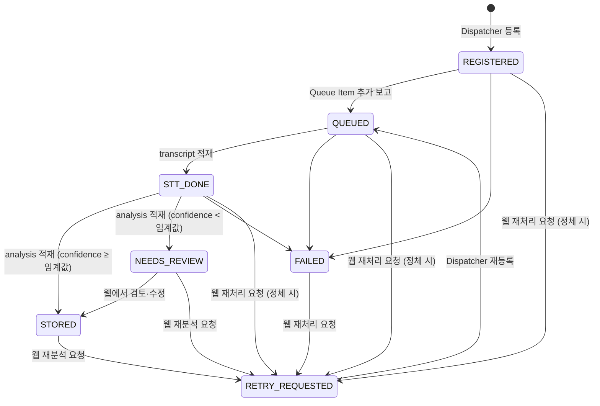
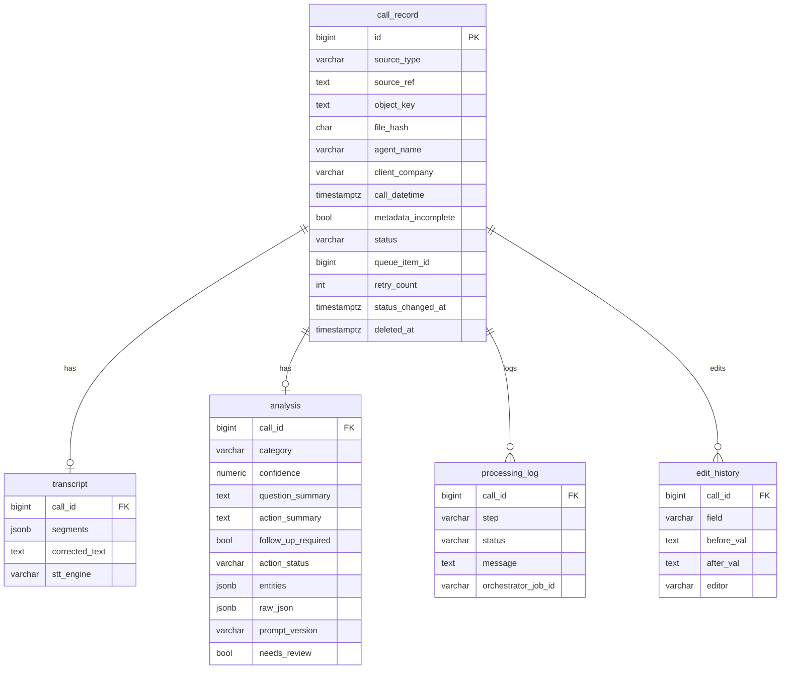
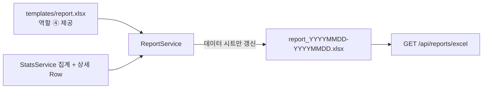
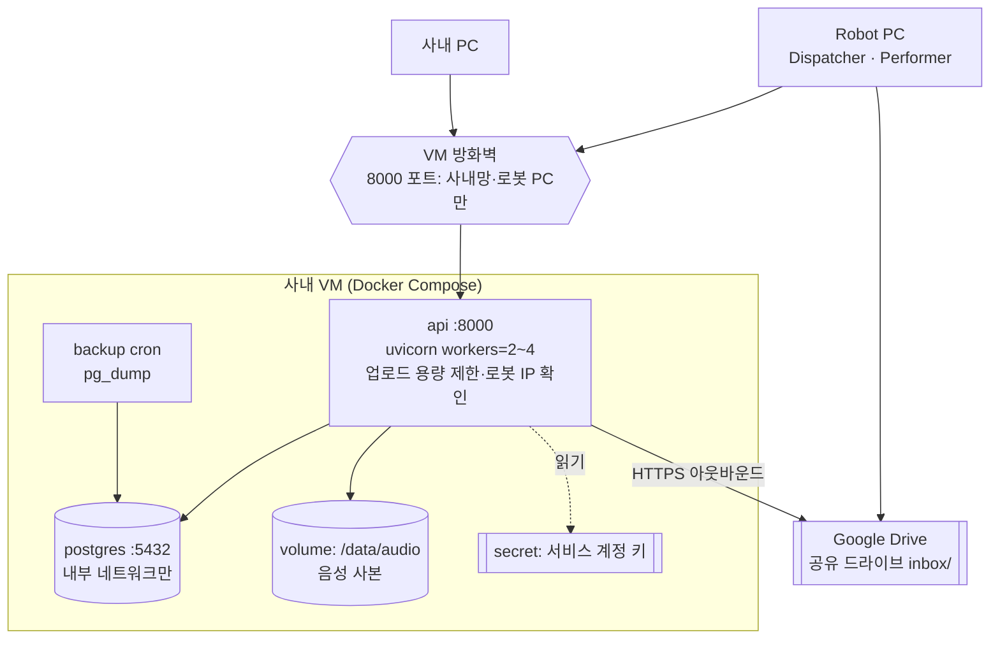

# Architecture — 백엔드 / DB / 서버 인프라

| 항목 | 내용 |
|---|---|
| 문서 버전 | v0.3 (A안 + 클라우드 폴더 기본 입력) |
| 작성일 | 2026-11-23 |
| 근거 | `prd.md`, `research.md` v0.2, `input_flow.md` |
| 범위 | 역할 ① 백엔드 / DB / 서버 인프라 |
| 전제 | 로그인 없음, 챗봇 없음, 녹취 인입은 **A안(RPA 직접 감지)**, 입력 위치는 **클라우드 폴더(Google Drive 공유 드라이브 [가정])**, 스택: FastAPI + PostgreSQL |

> 기술 선택의 비교·근거는 `research.md`, 인입 방식 결정은 `input_flow.md`, 이 문서는 **확정된 구조와 구현 규칙**을 정의합니다. **[결정 필요]** 표시는 research.md §10 미결 사항과 연결됩니다.

---

## 1. 설계 원칙

1. **처리 시작의 주도권은 RPA** — 백엔드는 로봇을 실행하지 않는다. Orchestrator API를 호출하지 않고 Webhook도 받지 않는다.
2. **DB 쓰기 주체는 백엔드 하나** — 웹·UiPath 로봇 모두 REST API로만 데이터를 변경한다.
3. **STT 전 선등록** — 로봇은 처리 전에 반드시 서버에 등록하므로, 처리 중 실패해도 DB에 흔적이 남는다.
4. **상태 전이는 서비스 계층 한 곳에서** — 모든 상태 변경은 `CallStateMachine`을 거친다.
5. **멱등성** — 로봇 적재 API는 같은 요청이 여러 번 와도 결과가 같다 (Queue 재시도 대비).
6. **원본과 독립된 음성 사본** — 서버는 등록 시 받은 음성 사본을 자체 저장소에 보관해 재생·재처리에 사용한다.
7. **PII 최소 보관** — DB에는 마스킹된 텍스트만 저장한다.

---

## 2. 시스템 컨텍스트



| 액터 | 백엔드와의 관계 | 인증 |
|---|---|---|
| 웹 대시보드 | `/api/*` 호출 (업로드·조회·수정·재처리 요청·통계·다운로드) | 없음 (네트워크 수준 통제) |
| Dispatcher 로봇 | `/api/robot/*` 호출 (등록, `QUEUED` 전이, 재처리 대상 조회) | `X-API-Key` |
| Performer 로봇 | `/api/robot/*` 호출 (음성 다운로드, 전사·분석 적재, 실패 보고) | `X-API-Key` |
| 클라우드 폴더 | 백엔드는 웹 업로드 파일을 `inbox/`에 **업로드만** 함 | Google 서비스 계정 (공유 드라이브 멤버) |
| Orchestrator | **직접 연동 없음** | — |

로봇과의 통신 방향은 **로봇 → 백엔드 단방향**이므로 백엔드는 사내망에만 두어도 된다. 백엔드의 외부 통신은 Google Drive API로 나가는 아웃바운드 HTTPS뿐이다.

---

## 3. 백엔드 내부 구조

### 3.1 계층



| 계층 | 책임 | 금지 사항 |
|---|---|---|
| Router | 요청 파싱, Pydantic 검증, 인증 의존성, 응답 직렬화 | 비즈니스 로직, DB 직접 접근 |
| Service | 유스케이스 단위 트랜잭션, 상태 전이, 저장소 조합 | HTTP 객체(Request/Response) 의존 |
| Repository | 쿼리 작성, 소프트 삭제 필터 기본 적용 | 상태 판단 로직 |
| Infra 어댑터 | 음성 사본 저장소, inbox 쓰기 | 도메인 규칙 |

### 3.2 디렉터리 구조

```
backend/
├── app/
│   ├── main.py                  # FastAPI 앱 생성, 라우터·미들웨어 등록
│   ├── core/
│   │   ├── config.py            # pydantic-settings (환경 변수)
│   │   ├── db.py                # 엔진·세션 팩토리
│   │   ├── logging.py           # JSON 구조화 로그, request_id
│   │   ├── errors.py            # 공통 예외 → 에러 응답 매핑
│   │   └── security.py          # 로봇 API Key 검증
│   ├── api/
│   │   ├── deps.py              # DB 세션, 서비스 주입
│   │   ├── web/                 # uploads.py, calls.py, retry.py, stats.py, reports.py
│   │   └── robot/               # calls.py
│   ├── schemas/                 # Pydantic: call, transcript, analysis(GenAI JSON), stats, retry, common
│   ├── models/                  # SQLAlchemy ORM
│   ├── repositories/
│   ├── services/
│   │   ├── call_service.py      # 웹 조회·수정·삭제
│   │   ├── retry_service.py     # 웹 재처리 요청 (상태 머신 호출)
│   │   ├── robot_service.py     # 등록·상태·적재·실패 보고
│   │   ├── upload_service.py    # 웹 업로드 검증 → InboxWriter
│   │   ├── state_machine.py
│   │   ├── stats_service.py     # 통계, 정체 건 집계
│   │   └── report_service.py    # openpyxl, 템플릿 기반
│   └── infra/
│       ├── storage/             # base.py, local.py, gcs.py
│       └── inbox/               # base.py, drive.py, local.py(개발용)
├── scripts/export_openapi.py    # OpenAPI → docs/api/openapi.json
├── docs/api/                    # convention.md(API 규약), openapi.json(계약, 커밋)
├── alembic/                     # 마이그레이션
├── templates/report.xlsx        # 역할 ④ 제공 엑셀 템플릿
├── tests/                       # unit / integration (testcontainers-postgres)
├── Dockerfile
├── pyproject.toml
└── .env.example
deploy/
├── docker-compose.yml           # api, db
└── docker-compose.dev.yml       # hot reload, adminer, 로컬 inbox 폴더(LocalInboxWriter)
```

---

## 4. 핵심 시퀀스

### 4.1 정상 처리 (폴더 적재 / 웹 업로드 공통)



- 등록 처리 순서: 음성 사본 저장 → DB INSERT. INSERT 실패 시 저장한 사본 삭제(보상 처리)
- 등록 후 Queue 추가 전에 Dispatcher가 죽으면 `REGISTERED`로 남고 파일은 `processing/`에 남는다 → 다음 주기에 Dispatcher가 `processing/`에 오래 머문 파일의 등록을 다시 시도 → `409 {status: REGISTERED}`를 받아 Queue 추가부터 이어서 진행 (`input_flow.md` §6.1)
- 파일명에서 담당자·통화 일시를 못 뽑은 경우: 빈 값으로 등록되고 `metadata_incomplete=true`. 처리는 정상 진행되며 웹에서 보정 (§5 참고)

### 4.2 실패 처리


- 로봇이 보고조차 못 하고 죽은 경우: DB에 `QUEUED`/`STT_DONE`이 남아 있으므로 **정체 감지**로 확인하고 (§12), 웹에서 재처리 요청으로 복구한다 (§4.3, §5)

### 4.3 재처리


- 재처리는 원본 폴더 대신 **서버 음성 사본**을 사용하므로 원본이 `failed/`·`done/`으로 이동했거나 삭제돼도 동작한다
- 재처리 요청 대상: `FAILED`·`NEEDS_REVIEW`·`STORED` 건, 그리고 **정체 건**(`REGISTERED`·`QUEUED`·`STT_DONE`에서 `STALE_THRESHOLD_MIN` 초과)
- 재처리 요청 시 `retry_count`를 1 올리고, Dispatcher는 이 값으로 Queue Reference(`call_id-retryN`)를 만든다
- 정체 건 재처리 후 이전 Queue 건이 뒤늦게 적재를 시도하면 상태가 맞지 않아 409로 거절된다 (정상 동작)

---

## 5. 상태 머신



| 호출 | 허용되는 현재 상태 | 결과 상태 |
|---|---|---|
| `PATCH /api/robot/calls/{id}/status` (QUEUED) | `REGISTERED`, `RETRY_REQUESTED` | `QUEUED` |
| `PUT .../transcript` | `QUEUED`, `STT_DONE`(재전송) | `STT_DONE` |
| `PUT .../analysis` | `STT_DONE`, `STORED`·`NEEDS_REVIEW`(재전송) | `STORED` / `NEEDS_REVIEW` |
| `POST .../logs` (FAIL) | `REGISTERED`, `QUEUED`, `STT_DONE` | `FAILED` |
| `POST /api/calls/{id}/retry` | `FAILED`, `NEEDS_REVIEW`, `STORED` / 정체된 `REGISTERED`·`QUEUED`·`STT_DONE` | `RETRY_REQUESTED` (`retry_count` +1) |
| `PATCH /api/calls/{id}` (검토 완료) | `NEEDS_REVIEW` | `STORED` |
| `PATCH /api/calls/{id}` (메타데이터 수정) | 모든 상태 | 상태 변화 없음. 담당자·통화 일시가 채워지면 `metadata_incomplete=false` |

- 허용되지 않은 전이 → `409 INVALID_STATE_TRANSITION`
- 정체 판단: `status_changed_at`이 `STALE_THRESHOLD_MIN`보다 오래됨. 정체되지 않은(처리 중인) 건의 재처리 요청은 409
- **메타데이터 누락은 상태가 아니다.** `metadata_incomplete` 표시로 별도 관리하며 처리 흐름을 막지 않는다 (`NEEDS_REVIEW`는 AI 신뢰도 전용)
- 동시성: 상태 변경 시 `SELECT ... FOR UPDATE`로 행 잠금
- 재전송(같은 상태로의 재적재)은 덮어쓰기로 처리 → 멱등
- 검토 필요(`NEEDS_REVIEW`) 판정: STT·GenAI 파이프라인의 판정(분류 신뢰도 0.6 미만 또는 화자 구분 불확실, `stt/schema/call_schema.json`의 `status`)을 그대로 따른다. 백엔드는 임계값으로 다시 판정하지 않는다

---

## 6. 데이터 아키텍처

### 6.1 ERD



- 컬럼 상세 DDL은 `research.md` §4.1 참조 (`metadata_incomplete`, `status_changed_at`, `retry_count` 포함)
- `agent_name`·`call_datetime`은 파일명 파싱 실패 시 비어 있을 수 있음 (NULL 허용)

### 6.2 인덱스 전략
| 용도 | 인덱스 |
|---|---|
| 중복 등록 | `UNIQUE(file_hash) WHERE deleted_at IS NULL` |
| 기간 조회·추이 | `call_record(call_datetime)` |
| 상태 모니터링·정체 감지·재처리 조회 | `call_record(status, status_changed_at)` |
| 유형 필터·집계 | `analysis(category)` |
| 키워드 검색 | `pg_trgm` GIN: `analysis(question_summary)`, `analysis(action_summary)`, `transcript(corrected_text)` |

### 6.3 데이터 생명주기
| 데이터 | 위치 | 보관 / 삭제 |
|---|---|---|
| 클라우드 원본 (`done/`) | Google Drive | 서버 사본이 있으므로 짧게 보관 후 정리 (RPA 담당) **[기간 결정 필요]** |
| 음성 사본 | 서버 저장소 | 보존 기간 경과 후 배치로 물리 삭제 **[기간 결정 필요]** |
| 전사·분석 | DB | 소프트 삭제(`deleted_at`), 물리 삭제는 음성 사본과 동일 주기 |
| 처리 로그 | DB | 90일 후 정리 **[가정]** |
| DB 백업 | `pg_dump` 일 1회 | 14일 보관 **[가정]** |

음성 사본·소프트 삭제 데이터·처리 로그 정리는 일 1회 **정리 배치**(`features.md` O-05)로 수행한다.

---

## 7. API 아키텍처

### 7.1 라우터 그룹
| Prefix | 소비자 | 인증 | 비고 |
|---|---|---|---|
| `/api/uploads`, `/api/calls`, `/api/stats`, `/api/reports` | 웹 | 없음 | VM 방화벽 IP 허용 목록 |
| `/api/robot/*` | Dispatcher · Performer | `X-API-Key` | 키는 Orchestrator Credential Asset 보관 |
| `/health` | 모니터링 | 없음 | DB·음성 저장소·Drive `inbox/` 접근 확인 |
| `/docs` | 개발자 | 운영 환경에서는 비활성(`DOCS_ENABLED=false`) | OpenAPI = 팀 간 계약서. 커밋된 `backend/docs/api/openapi.json`으로 공유 |

엔드포인트 목록은 `research.md` §5, 로봇 API 상세는 `input_flow.md` §9 참조.

### 7.2 공통 규약
세부 규약(필드 표기, 상태 코드, 목록·정렬·기간 필터, 시간·enum 표기, OpenAPI 공유)은 `backend/docs/api/convention.md`를 따른다.

```json
// 에러
{ "code": "DUPLICATE_FILE", "message": "이미 등록된 파일입니다.", "detail": { "existing_id": 123, "status": "REGISTERED" } }

// 목록
{ "items": [ ... ], "page": 1, "size": 20, "total": 154 }
```
| 에러 코드 | HTTP | 상황 |
|---|---|---|
| `VALIDATION_ERROR` | 422 | 요청·GenAI JSON 스키마 불일치 |
| `DUPLICATE_FILE` | 409 | 로봇 등록 시 해시 중복. `detail`에 기존 건의 `existing_id`·`status` 포함 |
| `INVALID_STATE_TRANSITION` | 409 | 허용되지 않은 상태 전이 (정체되지 않은 건의 재처리 요청 포함) |
| `NOT_FOUND` | 404 | 없음 또는 소프트 삭제됨 |
| `PAYLOAD_TOO_LARGE` | 413 | 요청 크기가 `MAX_UPLOAD_MB` 초과 |
| `UNSUPPORTED_MEDIA` | 415 | 허용되지 않은 파일 형식 |
| `UNAUTHORIZED` | 401 | 로봇 API Key 오류 |
| `FORBIDDEN_IP` | 403 | `/api/robot/*`를 허용되지 않은 IP에서 호출 |
| `INBOX_UNAVAILABLE` | 503 | 웹 업로드 시 Drive 업로드 실패 (API 오류·권한·할당량) |
| `BAD_REQUEST` | 400 | 요청 본문 파싱 실패 (multipart 깨짐 등) |
| `METHOD_NOT_ALLOWED` | 405 | 경로가 지원하지 않는 HTTP 메서드 |
| `INTERNAL_ERROR` | 500 | 처리되지 않은 서버 오류 |

- 시간은 모두 `TIMESTAMPTZ` 저장, API는 초 단위 ISO 8601(+09:00) 반환. 오프셋 없는 입력은 KST로 해석
- 모든 응답에 `X-Request-Id` 포함, 로봇은 이 값과 `call_id`를 UiPath 로그에 남김

---

## 8. 인프라 어댑터

### 8.1 AudioStorage (음성 사본)
```python
class AudioStorage(Protocol):
    def put(self, key: str, stream: BinaryIO, content_type: str) -> None: ...
    def open(self, key: str, byte_range: tuple[int, int] | None = None) -> BinaryIO: ...
    def delete(self, key: str) -> None: ...
    def signed_url(self, key: str, expires_sec: int) -> str | None: ...  # Local은 None
```
| 구현체 | Phase | 음성 재생 방식 |
|---|---|---|
| `LocalStorage` (Docker 볼륨) | 1~2 | API가 Range 응답으로 직접 스트리밍 |
| `GCSStorage` | 3 (선택) | 서명 URL로 302 리다이렉트 |

### 8.2 InboxWriter (웹 업로드 → 클라우드 inbox/)
```python
class InboxWriter(Protocol):
    def write(self, filename: str, stream: BinaryIO, content_type: str) -> str: ...  # 생성된 파일 ID 반환
    def check(self) -> None: ...  # 파일 생성 없이 쓰기 가능 여부 확인 (헬스 체크)
```
두 메서드 모두 실패하면 `InboxUnavailableError`를 던진다.

| 구현체 | 대상 | 비고 |
|---|---|---|
| `DriveInboxWriter` | Google Drive 공유 드라이브 `inbox/` | **기본**. 서비스 계정 + Drive API(`google-api-python-client`) |
| `LocalInboxWriter` | 로컬 폴더 | 개발·테스트 전용 |

업로드 규칙
- Drive API 업로드(resumable)로 전송. Drive는 업로드가 끝난 파일만 목록에 나타나므로 Dispatcher가 전송 중인 파일을 집지 않음
- 공유 드라이브 대상이므로 API 호출 시 `supportsAllDrives=true`
- 원래 파일명 유지(파일명 규칙으로 메타데이터 추출, 경로 성분 제거·NFC 정규화·확장자 소문자, Windows에서 쓸 수 없는 이름은 거절). Drive는 같은 이름을 허용하므로 별도 접미사 불필요
- 공개 파일 속성 `properties.source=web` 기록(`appProperties`는 요청한 앱만 읽을 수 있어 Dispatcher가 읽지 못할 수 있음) → Dispatcher가 등록 시 `source_type=WEB`으로 전달
- 웹 업로드 시 DB 등록은 하지 않음 (등록은 Dispatcher 단일 경로)
- 실패 시 지수 백오프로 2회 재시도 후 `503 INBOX_UNAVAILABLE` (어댑터는 `InboxUnavailableError`, 서비스가 503으로 변환)

---

## 9. 엑셀 보고서


- 템플릿의 차트는 데이터 시트 범위(테이블)를 참조하도록 역할 ④와 합의
- 슬라이서·피벗이 필수이면 openpyxl로 보존이 안 될 수 있으므로, 정기 보고서는 로봇이 생성한 파일을 업로드·제공하는 방식으로 전환 **[결정 필요]**
- 대용량 기간 요청 대비 최대 기간 제한(예: 1년) **[가정]**

---

## 10. 배포 아키텍처

### 10.1 사내 VM 단일 호스트 (Phase 1~2)



- PostgreSQL 포트는 외부에 노출하지 않음
- 리버스 프록시(Nginx) 없이 Uvicorn을 직접 노출한다. Nginx가 하던 역할은 다음으로 대체 (`back_stack.md` §6.1)
  - IP 허용 목록 → VM 방화벽 + `/api/robot/*` IP 확인 미들웨어
  - 업로드 용량 제한 → 앱에서 `MAX_UPLOAD_MB` 초과 시 413
  - HTTPS → 사내망 HTTP 기본, 필요 시 Uvicorn SSL 옵션 **[결정 필요]**
- 인바운드는 사내 PC와 로봇 PC → API(8000)뿐. **외부(Orchestrator Cloud 등)에서 백엔드로 들어오는 트래픽 없음**
- 아웃바운드는 Google Drive API(HTTPS)만 허용
- 서비스 계정 키(JSON)는 Docker secret 또는 읽기 전용 볼륨으로 주입, 이미지·Git에 포함 금지
- Phase 1(MVP)은 웹 업로드가 없으므로 서비스 계정 없이 시작 가능 (`INBOX_BACKEND=disabled`)

### 10.2 클라우드 (Phase 3, 선택)
| 구성 요소 | 서비스 |
|---|---|
| API | Cloud Run |
| DB | Cloud SQL for PostgreSQL |
| 음성 사본 | GCS |
| 입력 폴더 | Google Drive (Phase 1~2와 동일) |
| 접근 통제 | Cloud IAP 또는 Load Balancer + Cloud Armor IP 정책 |
| 비밀 | Secret Manager, Drive 접근은 Workload Identity로 서비스 계정 키 파일 제거 |

이 경우 로봇 PC → 클라우드 API 경로(공인 HTTPS)와 로봇 API Key 관리가 핵심 보안 경계가 된다.

### 10.3 환경 변수
| 이름 | 설명 |
|---|---|
| `DATABASE_URL` | PostgreSQL 접속 문자열 |
| `AUDIO_STORAGE_BACKEND` | `local` \| `gcs` |
| `AUDIO_STORAGE_ROOT` / `GCS_BUCKET` | 음성 사본 저장 위치 |
| `INBOX_BACKEND` | `drive` \| `local`(개발) \| `disabled`(Phase 1) |
| `DRIVE_INBOX_FOLDER_ID` / `INBOX_LOCAL_PATH` | 웹 업로드 대상 (Drive 폴더 ID / 로컬 경로) |
| `GOOGLE_APPLICATION_CREDENTIALS` | 서비스 계정 키 파일 경로 |
| `ROBOT_API_KEYS` | 로봇 API 키 (쉼표 구분, 교체 기간 중 2개 허용) |
| `MAX_UPLOAD_MB` | 요청 전체 크기 한도(MiB, 기본 100), 모든 API 공통, 앱에서 검사 |
| `ROBOT_ALLOWED_IPS` | `/api/robot/*` 호출 허용 IP (로봇 PC) |
| `ALLOWED_EXTENSIONS` | 웹 업로드 허용 확장자(쉼표 구분, 기본 `wav,mp3`). 내용 판정 규칙이 있는 형식만 가능(그 밖의 값은 시작 실패) |
| `STALE_THRESHOLD_MIN` | 정체 감지 기준(분) |
| `CORS_ORIGINS` | 프론트 주소 |
| `LOG_LEVEL` | 로그 레벨 `DEBUG` \| `INFO`(기본) \| `WARNING` \| `ERROR` |
| `DOCS_ENABLED` | `/docs`·`/redoc`·`/openapi.json` 노출 (기본 `true`, 운영 `false`) |

---

## 11. 보안 아키텍처

| 경계 | 통제 |
|---|---|
| 사용자 → 웹/API | 사내망/VPN, VM 방화벽 IP 허용 목록, HTTPS는 필요 시 Uvicorn SSL |
| 로봇 → API | API Key (`X-API-Key`), 키 교체 시 2개 동시 허용 기간 지원, 로봇 PC IP만 `/api/robot/*` 허용(앱 미들웨어, `ROBOT_ALLOWED_IPS`) |
| API → 클라우드 폴더 | 서비스 계정은 공유 드라이브(또는 `inbox/` 폴더) **기여자** 역할 **[확인 필요: E-01]**, 키 파일 서버 외부 반출 금지·주기적 교체 |
| 클라우드 폴더 자체 | 공유 드라이브 멤버를 담당자·RPA 계정·서비스 계정으로 한정, 링크 공유 금지, `done/` 보관 기간 단축 |
| API → DB | 전용 DB 계정(앱 권한만), 마이그레이션 계정 분리 |
| 업로드 파일 (웹·로봇) | 확장자 + 매직 바이트 검증(둘이 같은 형식이어야 함, 클라이언트 MIME은 판정에 쓰지 않고 판정 형식의 정규 MIME 사용)(웹 업로드 기준), 음성 사본은 UUID 파일명, 실행 권한 없는 볼륨 |
| 데이터 | 마스킹된 텍스트만 저장, 음성 재생·다운로드 접근 로그 기록 |
| 오조작 | 소프트 삭제, `edit_history`, 일일 백업 |
| 비밀 | `.env`(Git 제외) → 클라우드에서는 Secret Manager |

Orchestrator 자격 증명·Webhook 시크릿은 백엔드에 존재하지 않는다 (A안).

---

## 12. 관측성 / 운영

| 항목 | 구현 |
|---|---|
| 로그 | JSON 구조화 로그(`request_id`, `call_id`, `path`, `status`, `latency_ms`), Docker 로그 로테이션 |
| 처리 추적 | `processing_log` 테이블 — 웹 상세 화면에서 단계별 이력 조회 |
| 헬스 체크 | `GET /health` → DB `SELECT 1`, 음성 저장소 쓰기, Drive `inbox/` 폴더 메타데이터 조회 가능 여부 |
| **정체 감지** | `REGISTERED`·`QUEUED`·`STT_DONE`·`RETRY_REQUESTED` 상태에서 `status_changed_at`이 `STALE_THRESHOLD_MIN`(기본 30분 **[가정]**) 초과 → 통계 API에 정체 건수로 노출, 목록 API `stale=true` 필터로 해당 건 조회, 대시보드 경고. 로봇 크래시·Dispatcher 중단을 잡는 **유일한 서버 측 장치**. 복구: `REGISTERED`·`QUEUED`·`STT_DONE` 정체 건은 웹 재처리 요청, `RETRY_REQUESTED` 정체는 Dispatcher 자체가 멈춘 것이므로 RPA 파트에 로봇 점검 요청 |
| 운영 지표 | 상태별 건수, 실패율, 평균 처리 시간(`REGISTERED` → `STORED`) |
| 백업·복구 | `pg_dump` 일 1회 + 음성 사본 볼륨 백업, 복구 절차 문서화 |

---

## 13. 테스트 전략

| 수준 | 대상 | 도구 |
|---|---|---|
| 단위 | 상태 머신(§5 전이표 전체), GenAI JSON 스키마 검증, 정체 감지 쿼리, 통계 계산 | pytest |
| 통합 | Repository·API (실제 PostgreSQL), LocalInboxWriter(임시 폴더), DriveInboxWriter(테스트용 Drive 폴더, 수동 실행) | pytest + testcontainers |
| 계약 | 로봇 API 요청/응답 예시 JSON을 역할 ③④와 공유, 테스트 픽스처로 사용 | OpenAPI + 샘플 JSON |
| 로봇 시뮬레이션 | Dispatcher·Performer 호출 순서를 흉내 내는 스크립트로 등록 → QUEUED → 적재 / 실패 / 재처리 시나리오 검증 | pytest 시나리오 (UiPath 없이 백엔드 단독 E2E) |

---

## 14. 구현 단계와 아키텍처 범위

| Phase | 활성 구성 요소 | 비활성 |
|---|---|---|
| 1 (MVP) | 로봇용 API(등록·상태·적재·로그), 조회 API, LocalStorage(음성 사본), DB | 웹 업로드(`INBOX_BACKEND=disabled`), 재처리, 엑셀 다운로드 |
| 2 | + 웹 업로드(DriveInboxWriter), 재처리, 수정/삭제, 통계·정체 감지, 엑셀 다운로드, 음성 스트리밍, VM 배포(방화벽 IP 제한) | — |
| 3 (선택) | + SSE, GCSStorage, 클라우드 배포 | — |

작업 단위와 담당자 배정은 `features.md` 참조.
