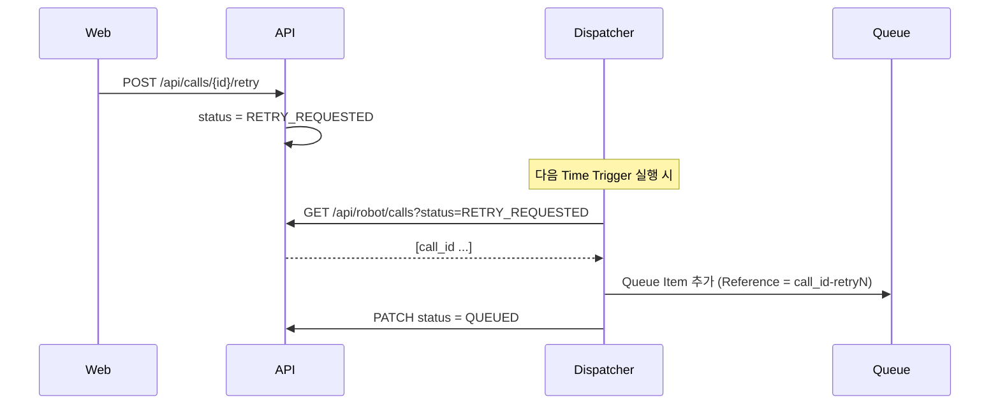
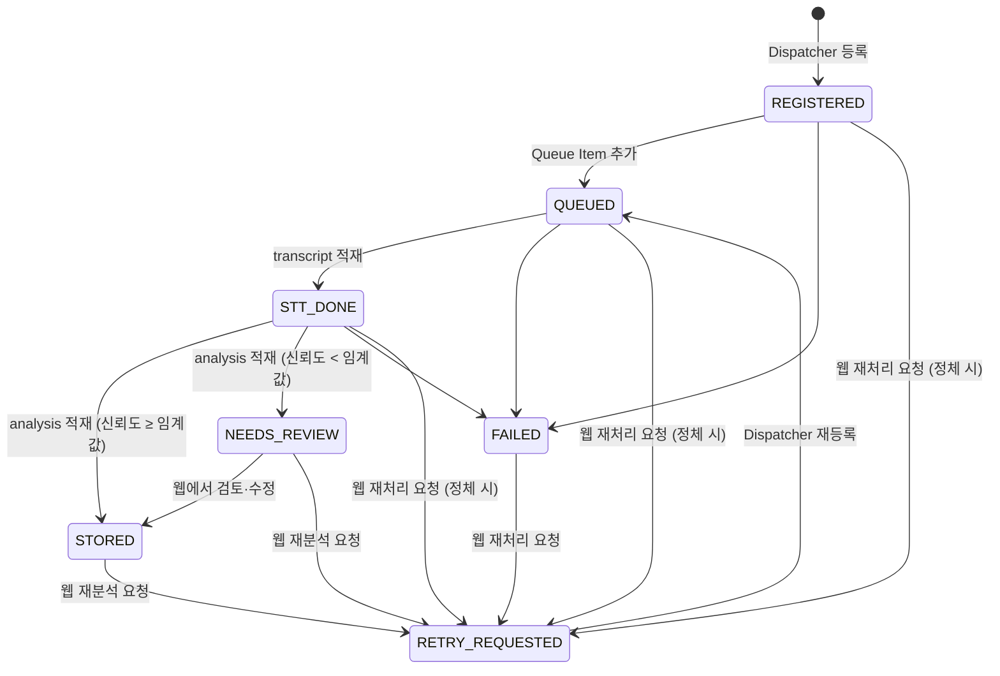

# 음성 파일 인입 방식 결정 — RPA 직접 감지 (A안)

| 항목 | 내용 |
|---|---|
| 문서 버전 | v0.2 (입력 위치: 클라우드 폴더 기본) |
| 작성일 | 2026-11-23 |
| 상태 | **채택** |
| 관련 문서 | `prd.md` (IN-01~06, STT-*, RPA-*), `research.md` §3, `architecture.md` §4 |
| 관련 역할 | ① 백엔드/DB, ③ GenAI & STT, ④ RPA 코어 |

---

## 1. 결정 요약

녹취 파일이 **클라우드 폴더(Google Drive `inbox/`)**에 적재되면 **UiPath RPA가 직접 감지해 STT·GenAI 처리를 진행**하고, 백엔드 서버는 **결과를 받아 저장·조회하는 역할**만 맡는다.

- 입력 위치는 클라우드 폴더 하나다. 사용자가 직접 올리거나, 웹에서 올리면 서버가 같은 폴더에 대신 올린다.
- 클라우드 서비스는 Google Drive로 가정한다 (PRD에 언급된 Google Cloud/Drive) **[확정 필요]**.
- 서버가 Orchestrator를 호출해 로봇을 실행하는 B안(서버 경유)은 채택하지 않는다.
- 파일 인입부터 처리 시작까지의 **주도권은 RPA**에 있다.
- 백엔드는 Orchestrator API(OAuth, Queue 등록)를 연동하지 않는다.

---

## 2. 검토한 대안

| | **A. RPA 직접 감지 (채택)** | B. 서버 경유 |
|---|---|---|
| 흐름 | 파일 적재 → RPA 감지 → 서버 등록 → STT·GenAI → 서버 적재 | 파일 적재 → 서버 등록 → Orchestrator Queue 등록 → RPA 처리 → 서버 적재 |
| 장점 | 구성 단순, 구현 빠름, Orchestrator API·OAuth·Webhook 연동 불필요, 서버 장애가 처리 시작을 막지 않음 | 진입점 일원화, 서버가 처리 시작 시점을 통제 |
| 단점 | 로봇이 감지하기 전까지 서버가 파일 존재를 모름, 재처리를 서버가 직접 시작할 수 없음 | Orchestrator 연동 공수, 서버가 단일 장애 지점 |

### 채택 이유
1. 프로젝트 규모(담당자 3명, 일 통화량 수십~백여 건)에서 B안의 추가 연동 공수가 효과에 비해 크다.
2. 인입 경로(클라우드 폴더)가 RPA의 Google Drive 액티비티로 다루기 쉬운 형태다.
3. A안의 약점(누락·중복·재처리)은 §6의 보완책으로 충분히 줄일 수 있다.

---

## 3. 전체 흐름

```mermaid
flowchart LR
    subgraph IN["입력"]
        U[사용자 직접 업로드]
        W[웹 업로드]
        C[[클라우드 폴더<br/>Google Drive inbox/]]
    end

    subgraph RPA["UiPath"]
        D[Dispatcher 로봇<br/>클라우드 폴더 확인·등록·Queue 추가]
        Q[(Orchestrator Queue)]
        P[Performer 로봇<br/>STT → GenAI → PII 마스킹 → 엑셀·CRM]
    end

    subgraph BE["백엔드"]
        API[FastAPI]
        DB[(PostgreSQL)]
        ST[(음성 저장소)]
    end

    U --> C
    W -->|업로드| API -->|Drive API로 inbox/에 업로드| C
    C --> D
    D -->|1. 등록 + 음성 업로드| API
    D -->|2. Queue Item {call_id}| Q
    Q --> P
    P -->|3. transcript / analysis 적재| API
    API --> DB
    API --> ST
```

### 3.1 단계별 처리

| # | 주체 | 처리 | 결과 상태 |
|---|---|---|---|
| 1 | 사용자 / 서버 | 사용자가 클라우드 `inbox/`에 직접 올리거나, 웹에 올리면 서버가 `inbox/`에 대신 업로드 | — |
| 2 | Dispatcher | 주기적으로 클라우드 `inbox/` 확인, 신규 파일을 `processing/`으로 이동 | — |
| 3 | Dispatcher | `POST /api/robot/calls`로 서버 등록 (메타데이터 + 해시 + 음성 파일) | `REGISTERED` |
| 4 | Dispatcher | 서버가 돌려준 `call_id`로 Orchestrator Queue Item 추가 | `QUEUED` |
| 5 | Performer | Queue Item 수신 → 음성 파일로 STT 수행 (화자 분리) | — |
| 6 | Performer | `PUT /api/robot/calls/{id}/transcript` | `STT_DONE` |
| 7 | Performer | GenAI 분류·요약·JSON 추출, PII 마스킹 | — |
| 8 | Performer | `PUT /api/robot/calls/{id}/analysis` | `STORED` / `NEEDS_REVIEW` |
| 9 | Performer | 엑셀 기입, (선택) CRM 입력 | — |
| 10 | Performer | 원본 파일을 `done/`으로 이동 (실패 시 `failed/`) | — |

> **핵심 규칙: STT를 시작하기 전에 반드시 서버 등록(3단계)을 먼저 한다.** 그래야 처리 도중 실패해도 대시보드에 해당 건이 남아 누락이 보인다.

---

## 4. 입력 경로 상세

### 4.1 클라우드 폴더 구조 (Google Drive)

```
[공유 드라이브] 콜센터_녹취/
├── inbox/        # 유일한 입력 위치 (사용자 직접 업로드 + 서버의 웹 업로드 대행)
├── processing/   # Dispatcher가 집어간 파일
├── done/         # 처리 완료
└── failed/       # 처리 실패 (사유는 서버 processing_log에 기록)
```

- 개인 "내 드라이브"가 아닌 **공유 드라이브**에 둔다. 담당자 퇴사·계정 변경에 영향받지 않고, 서버의 서비스 계정도 멤버로 추가할 수 있다 **[확인 필요: 조직의 Google Workspace 공유 드라이브 사용 가능 여부]**
- Drive에서 "폴더 이동"은 파일의 상위 폴더(parent)를 바꾸는 것이다

### 4.2 사용자 직접 업로드

| 항목 | 방식 |
|---|---|
| 업로드 | 담당자가 브라우저 또는 Google Drive 데스크톱 앱으로 `inbox/`에 녹취 파일을 올린다 |
| 감지 | Orchestrator **Time Trigger**로 Dispatcher를 N분(예: 1~5분)마다 실행해 `inbox/` 파일 목록을 조회 **[권장]**. UiPath Integration Service의 Google Drive "파일 생성" 이벤트 트리거는 대안 **[확인 필요]** — 이벤트 유실 시 복구가 어려워 폴링을 기본으로 함 |
| 업로드 완료 판정 | Drive는 업로드가 끝난 파일만 목록에 나타나므로 별도 대기 불필요. 데스크톱 앱 동기화 중인 파일은 크기 0 또는 생성 직후일 수 있어 "생성 후 1분 경과" 조건을 둔다 **[가정]** |
| 중복 방지 | 파일을 `processing/`으로 **이동**한 로봇만 처리. 이동 시 파일이 이미 `inbox/`에 없으면 다른 로봇이 선점한 것 |
| 파일 식별 | Drive 파일 ID를 서버 등록 시 `source_ref`로 함께 전송 |
| 지원 형식 | `.wav`, `.mp3` 외 파일은 `failed/`로 이동 |

### 4.3 웹 업로드 (서버가 클라우드에 대행 업로드)

웹 업로드는 **별도 처리 경로를 만들지 않고** 서버가 파일을 클라우드 `inbox/`에 올리는 것으로 끝낸다. 이후 처리는 4.2와 동일하다.

| 항목 | 방식 |
|---|---|
| 서버 인증 | Google Cloud **서비스 계정** + Drive API. 서비스 계정을 공유 드라이브에 "콘텐츠 관리자" 이하 권한으로 추가 **[확인 필요]** |
| 업로드 | 서버가 확장자·MIME·용량 검증 후 Drive API로 `inbox/`에 업로드 |
| 출처 표시 | 업로드 시 Drive 파일 속성(`appProperties`)에 `source=web`을 기록 → Dispatcher가 등록 시 `source_type=WEB`으로 전달 (직접 업로드는 `DRIVE`) |
| DB 등록 | 하지 않음 (중복 등록 방지). 업로드 화면에는 "접수됨, 처리 대기" 안내만 표시 |
| 장점 | 로봇은 입력 위치를 클라우드 `inbox/` 하나만 알면 됨 |

### 4.4 로컬 폴더 (개발·테스트 전용)

로컬 개발 시에는 Drive 대신 로컬 폴더에 같은 `inbox/ processing/ done/ failed/` 구조를 만들어 테스트할 수 있다. 운영 입력 경로로는 사용하지 않는다.

---

## 5. 역할별 책임

### 5.1 ④ RPA 코어 — Dispatcher
- Time Trigger 스케줄 설정, Google Drive `inbox/` 목록 조회(UiPath Google Workspace 액티비티), 업로드 완료 판정
- `inbox → processing` 이동, 메타데이터 추출(파일명 규칙 §7), SHA-256 계산
- 서버 등록 API 호출, Queue Item 추가 (`Reference = call_id`)
- 재처리 요청 조회 및 Queue 재등록 (§6.3)

### 5.2 ③ GenAI & STT + ④ RPA 코어 — Performer
- Queue Item 처리 (REFramework 기반, Queue 재시도 횟수 설정)
- STT → GenAI → PII 마스킹 (③), 결과 적재 API 호출
- 엑셀 기입·CRM 입력 (④), 파일 `done/` 또는 `failed/` 이동
- 실패 시 `POST /api/robot/calls/{id}/logs`로 사유 보고 후 상태 `FAILED`

### 5.3 ① 백엔드
| 기능 | 내용 |
|---|---|
| 등록 API | `POST /api/robot/calls` (multipart: 음성 파일 + 메타데이터). 해시 중복이면 `409` + 기존 `call_id` 반환 |
| 음성 보관 | 등록 시 받은 음성을 서버 저장소에 보관 → 웹 재생용. 원본 폴더와 독립 |
| 결과 적재 API | `PUT .../transcript`, `PUT .../analysis` (스키마 검증, 상태 전이) |
| 로그 API | `POST .../logs` (실패 시 상태 `FAILED` 전이 포함) |
| 재처리 | 웹에서 재처리 요청 → 상태 `RETRY_REQUESTED`로 표시만 함 (§6.3) |
| 웹 업로드 | 서비스 계정으로 Drive `inbox/`에 업로드 (DB 등록 없음) |
| 정체 감지 | `REGISTERED`·`QUEUED`·`STT_DONE`·`RETRY_REQUESTED`가 일정 시간(예: 30분) 이상 머문 건을 대시보드에 경고 표시, 웹 재처리로 복구 |
| 메타데이터 보정 | 파일명 파싱 실패로 비어 있는 담당자·고객사·통화 일시를 웹에서 수정 (`metadata_incomplete` 해제) |
| 제외 | Orchestrator OAuth, AddQueueItem, StartJobs 호출 |

---

## 6. A안의 약점과 보완책

### 6.1 누락 (파일이 처리되지 않고 사라지는 문제)
| 상황 | 보완 |
|---|---|
| 로봇이 꺼져 있음 | 파일이 `inbox/`에 그대로 남음 → 로봇 재기동 시 처리. Time Trigger 방식이라 이벤트 유실 없음 |
| 등록 후 처리 중 로봇 크래시 | 서버에 `QUEUED`·`STT_DONE`으로 남음 → Orchestrator Queue가 `Abandoned` 처리 후 재시도. 그래도 멈춰 있으면 정체 감지 경고 → 웹에서 재처리 요청으로 복구 |
| 등록 전 또는 Queue 추가 전 크래시 | 파일이 `processing/`에 남음 → Dispatcher가 매 실행 시 `processing/`에 일정 시간(예: 10분 **[가정]**) 이상 머문 파일의 **등록을 다시 시도**. 응답에 따른 처리는 §6.2 |

### 6.2 중복
| 상황 | 보완 |
|---|---|
| 같은 파일 재적재 / 재등록 시도 | 서버 해시 중복 검사 → `409 DUPLICATE_FILE`(`detail.existing_id`, `detail.status`) → 아래 표에 따라 처리 |
| 여러 로봇의 동시 감지 | `processing/`으로의 이동을 선점 수단으로 사용 |
| 결과 API 재전송 | `PUT` 적재 API는 멱등 (같은 값 재전송 시 동일 결과) |

**등록 응답별 Dispatcher 처리**

409 응답의 "기존 건 상태"는 에러 본문 `detail.status`, 기존 건 ID는 `detail.existing_id`에서 읽는다 (에러 형식: `backend/docs/api/convention.md` §3).

| 응답 | 기존 건 상태 | 의미 | Dispatcher 처리 |
|---|---|---|---|
| `201 {call_id}` | — | 신규 등록 | Queue 추가 → `QUEUED` 보고 |
| `409` | `REGISTERED` | 이전 실행이 Queue 추가 전에 중단됨 | `detail.existing_id`로 Queue 추가부터 이어서 진행 → `QUEUED` 보고 |
| `409` | `QUEUED`·`STT_DONE`·`RETRY_REQUESTED` | 이미 처리 중 | 아무것도 하지 않음 (멈춰 있으면 서버 정체 감지 → 웹 재처리) |
| `409` | `STORED`·`NEEDS_REVIEW` | 이미 처리 완료된 같은 파일 | 파일을 `done/`으로 이동 |
| `409` | `FAILED` | 이미 실패 처리된 같은 파일 | 파일을 `failed/`로 이동 (복구는 웹 재처리) |

### 6.3 재처리 (서버가 로봇을 직접 실행할 수 없음)

- 재처리 요청 대상: `FAILED`·`NEEDS_REVIEW`·`STORED` 건, 그리고 정체된 `REGISTERED`·`QUEUED`·`STT_DONE` 건
- 재처리 요청 시 서버가 `retry_count`를 1 올리고, Dispatcher는 조회 결과의 `retry_count`로 Reference(`call_id-retryN`)를 만든다
- 재처리 시 음성은 서버 저장소에서 내려받음 (`GET /api/robot/calls/{id}/audio`) → 원본 폴더에서 파일이 옮겨졌어도 문제없음
- 반영까지 최대 Time Trigger 주기만큼 지연됨 (허용)
- 정체 건 재처리 후 이전 Queue 건이 뒤늦게 적재를 시도하면 409로 거절된다 → Performer는 해당 Queue 건을 실패 보고 없이 종료 **[RPA 파트와 합의 필요]**

---

## 7. 파일명 규칙 **[결정 필요]**

Dispatcher가 메타데이터를 파일명에서 추출한다.

```
{통화일시 yyyyMMdd_HHmmss}_{담당자}_{고객사}.{wav|mp3}
예) 20261123_143005_김상담_A산업.mp3
```
- 규칙에 맞지 않는 파일: 추출하지 못한 메타데이터를 비워 등록 → 서버가 `metadata_incomplete=true`로 표시 → **처리(STT·분석)는 정상 진행** → 웹에서 담당자·고객사·통화 일시를 보정하면 표시 해제 **[가정]**
- 메타데이터 누락은 처리 상태(`NEEDS_REVIEW` 등)와 별개로 관리한다. `NEEDS_REVIEW`는 AI 신뢰도가 낮은 경우에만 쓴다
- 녹취 장비가 파일명을 자동 생성한다면 그 형식에 맞춰 파싱 규칙 확정 필요

---

## 8. 상태 머신 (A안 기준)



전이 허용 조건 상세는 `architecture.md` §5 참조.

---

## 9. 로봇용 API (A안 기준)

| Method | Endpoint | 호출자 | 설명 |
|---|---|---|---|
| POST | `/api/robot/calls` | Dispatcher | 등록 (multipart: `file`, `call_datetime`, `agent_name`, `client_company`, `file_hash`, `source_type`, `source_ref`) → `201 {call_id}` / `409 DUPLICATE_FILE` (`detail.existing_id`, `detail.status`, §6.2). 메타데이터는 추출 실패 시 생략 가능 |
| PATCH | `/api/robot/calls/{id}/status` | Dispatcher | `QUEUED` 전이 (`queue_item_id` 포함). `REGISTERED`·`RETRY_REQUESTED`에서만 허용 |
| GET | `/api/robot/calls?status=RETRY_REQUESTED` | Dispatcher | 재처리 대상 조회 (`call_id`, `retry_count`) |
| GET | `/api/robot/calls/{id}/audio` | Performer | 재처리 시 음성 다운로드 |
| PUT | `/api/robot/calls/{id}/transcript` | Performer | 전사 적재 |
| PUT | `/api/robot/calls/{id}/analysis` | Performer | 분석 JSON 적재 |
| POST | `/api/robot/calls/{id}/logs` | 둘 다 | 단계 로그, `FAILED` 보고 |

인증: 모든 `/api/robot/*`는 `X-API-Key` 필수.

---

## 10. 기존 문서에 미치는 영향 (2026-11-23 반영 완료)

| 문서 | 변경 사항 |
|---|---|
| `prd.md` | §4 파이프라인에 Dispatcher/Performer 구조 반영, 상태 값 갱신(`REGISTERED`, `RETRY_REQUESTED` 추가, `UPLOADED`·`ANALYZED` 제거) |
| `research.md` | §3.2·§3.3·§3.4(서버 → Orchestrator 연동) 삭제 또는 "미채택"으로 표시, WBS B-07(Orchestrator 연동)·B-08(Webhook) 제거 또는 축소 |
| `architecture.md` | §2 컨텍스트에서 API → Orchestrator 호출 제거, §4.1 시퀀스를 본 문서 §3·§6.3으로 교체, §5 상태 머신 교체, §8.2 OrchestratorClient 제거, 웹 업로드 API를 "inbox 저장"으로 변경 |
| 전체 (v0.2) | 입력 위치를 공유 폴더 → **클라우드 폴더(Google Drive) 기본**으로 변경, 웹 업로드는 서버가 Drive `inbox/`에 대행 업로드 |

### Webhook은?
A안에서는 정상·실패 보고를 모두 로봇이 API로 하므로 **Orchestrator Webhook은 필수가 아니다.** 로봇 크래시처럼 로봇이 보고하지 못하는 실패는 서버의 정체 감지(§5.3)로 확인한다. 이후 필요하면 `job.faulted` 수신만 선택적으로 추가한다.

---

## 11. 미결 사항

1. 클라우드 서비스 확정 (Google Drive 가정) 및 공유 드라이브 사용 가능 여부
2. 서버용 서비스 계정 발급과 공유 드라이브 권한 부여 (웹 업로드 대행용), RPA용 Google 계정·OAuth 연결 방식
3. Dispatcher 실행 주기 (처리 지연 허용 범위)
4. 파일명 규칙 / 녹취 장비의 자동 파일명 형식
5. 로봇 라이선스 수 (Dispatcher·Performer를 같은 로봇에서 돌릴지)
6. 클라우드 감지 방식: 폴링(기본) vs Integration Service 이벤트 트리거
7. 클라우드 `done/` 파일 보관 기간 (서버 저장소에 사본이 있으므로 짧게 가능)
8. 녹취 파일을 외부 클라우드에 두는 것에 대한 개인정보·보안 정책 확인
